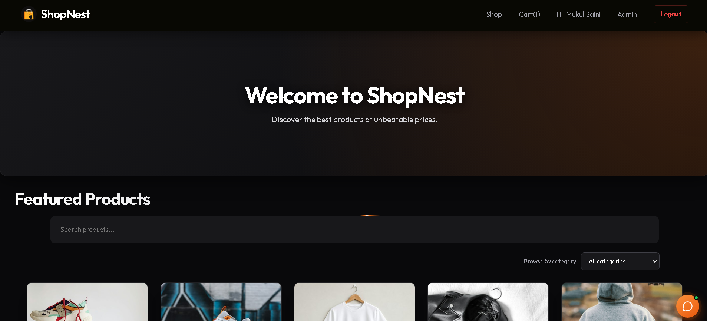
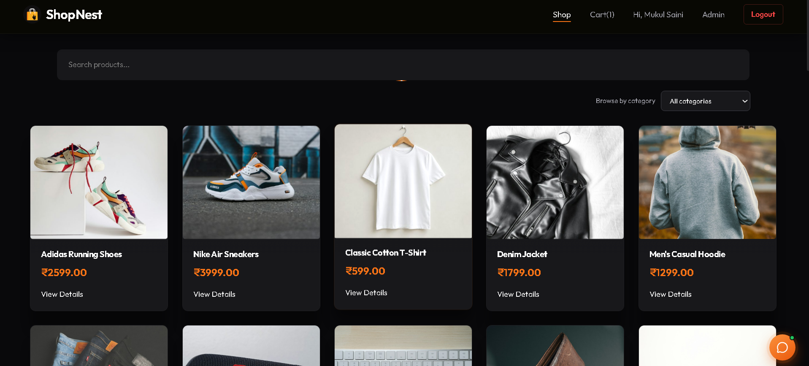
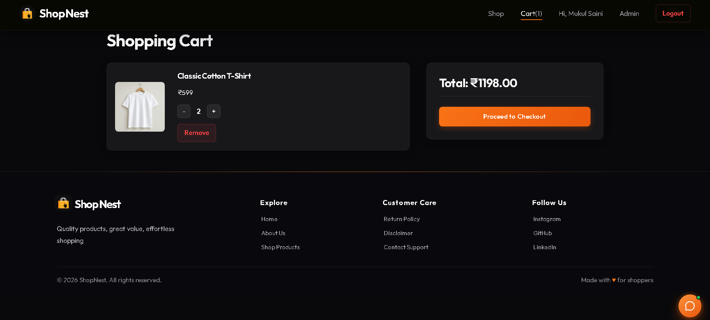
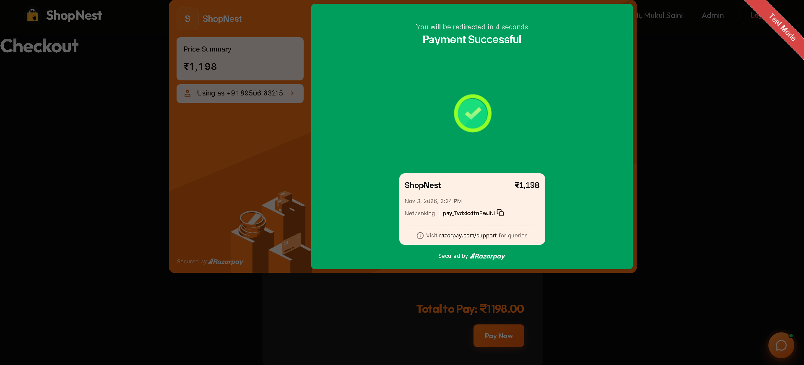
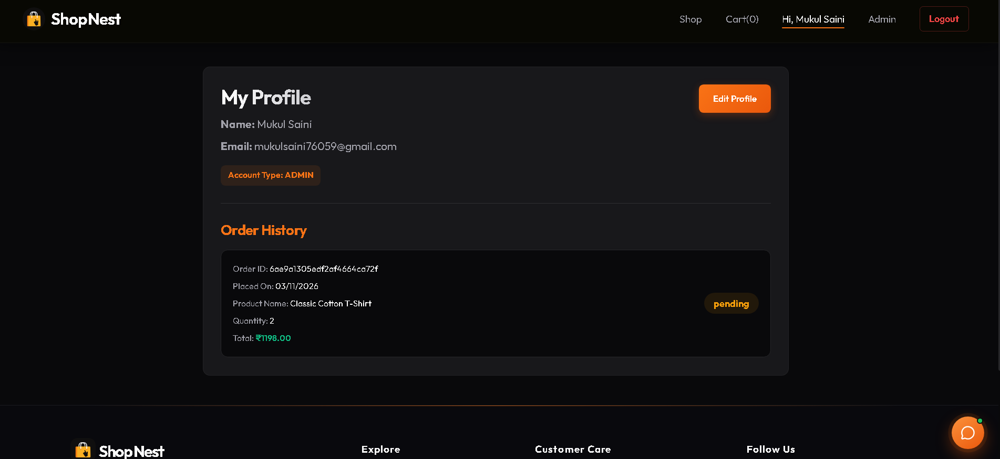
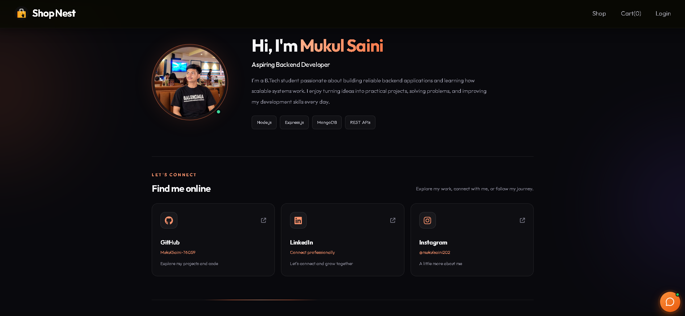
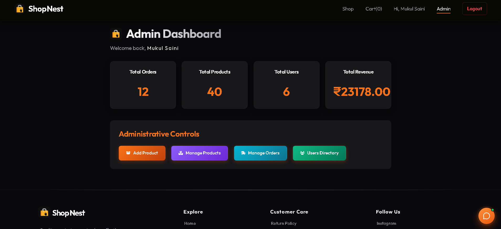
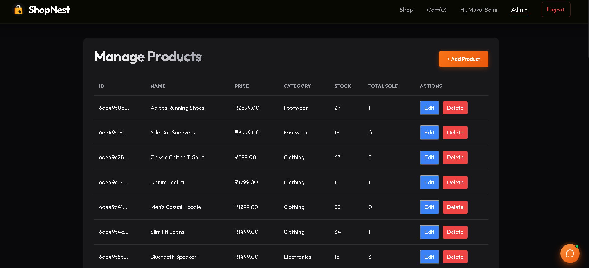
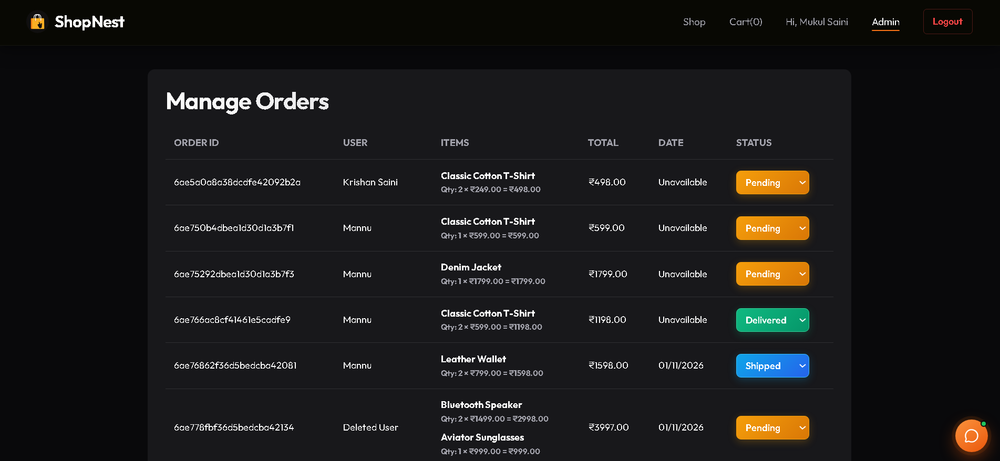
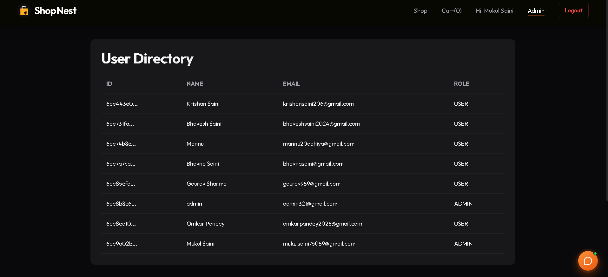

<div align="center">


[](https://git.io/typing-svg)


<p>
  <a href="https://shop-nest-three-sigma.vercel.app">
    
  </a>
  
  
</p>


<p>
  
  
  
  
  
  
</p>

</div>

---

## ✨ About the Project

**ShopNest** is a full-stack e-commerce web application built on the **MERN stack**. It follows a clean **client–server architecture**: a React frontend consumes a **RESTful API** built with Node.js and Express, backed by MongoDB for persistent storage.

> 🎯 Goal: build a production-style shopping experience while applying real backend concepts — authentication, authorization, API design, and database modeling.

---

## 🔗 Live Demo

👉 **[shop-nest-three-sigma.vercel.app](https://shop-nest-three-sigma.vercel.app)**


---

## 🛡️ Admin Demo Access

<div align="center">

### ⚡ Explore the ShopNest Admin Panel

Want to explore the admin dashboard? Use the demo credentials below to
log in and view the available admin features.


</div>

| 🔑 Credential | 📋 Demo Details |
|:---|:---|
| **Email** | `admin321@gmail.com` |
| **Password** | `Admin@321` |
| **Access** | Admin Panel — View Only |

<div align="center">

<a href="https://shop-nest-three-sigma.vercel.app">
  
</a>

</div>

### 🔒 Demo Account Restrictions

- 👀 **View Only:** Explore the admin dashboard, products, orders, and user directory.
- 🚫 **No Editing:** Do not modify existing products, orders, or user details.
- 🗑️ **No Deleting:** Do not delete products, orders, or user accounts.
- 🤝 **Shared Account:** This demo account is available for other visitors to explore the project.

> **Note:** These restrictions describe the intended use of the demo account. Actual edit/delete permissions must also be disabled or enforced by the backend to guarantee read-only access.


## 📸 Screenshots

Explore the different pages and features of ShopNest.

### 🛍️ User Interface

| Home | Products |
|:---:|:---:|
|  |  |

| Shopping Cart | Order Confirmation |
|:---:|:---:|
|  |  |

| User Profile | About Us |
|:---:|:---:|
|  |  |

### ⚙️ Admin Panel

| Admin Dashboard | Manage Products |
|:---:|:---:|
|  |  |

| Manage Orders | User Directory |
|:---:|:---:|
|  |  |

## 🧠 Concepts & Skills Applied

| Area | Concepts |
|------|----------|
| 🏗️ **Architecture** | MERN stack, client–server model, separate `frontend/` and `backend/` apps, MVC-style folder structure |
| 🌐 **API Design** | RESTful APIs, CRUD operations, route handling, HTTP methods & status codes |
| 🔐 **Security** | JWT authentication, password hashing (bcrypt), protected routes, role-based access control, CORS |
| 🗄️ **Database** | MongoDB, Mongoose schemas & models, data relationships, queries |
| ⚙️ **Backend** | Node.js, Express.js, middleware, controllers, error handling, environment variables (`.env`) |
| 🎨 **Frontend** | React components, hooks, props & state, React Router, Axios API integration, responsive UI |
| 🚀 **Deployment** | Vercel hosting, Git & GitHub version control |

---

## 🛍️ Features

- 👤 **User Authentication** — Register / Login with JWT
- 🛒 **Shopping Cart** — add, remove, update quantities
- 📦 **Product Catalog** — browse and view product details
- 🧾 **Order Management** — place and track orders
- 🛡️ **Admin Panel** — manage products, orders and users
- 🔒 **Protected Routes** — secure pages & role-based access
- 📱 **Responsive Design** — works across devices

---

## 🧰 Tech Stack

**Frontend** &nbsp;   

**Backend** &nbsp;   

**Database** &nbsp;  

**Tools** &nbsp;    

---

## 📁 Project Structure

```bash
ShopNest/
├── backend/                     # Node.js + Express REST API
│   ├── models/                  # Mongoose schemas
│   ├── routes/                  # API routes
│   ├── controllers/             # Business logic
│   ├── middleware/              # Authentication & error handling
│   └── server.js                # Entry point
│
├── frontend/                    # React client
│   ├── src/
│   │   ├── components/
│   │   ├── pages/
│   │   └── App.js
│   └── package.json
│
├── screenshots/                 # Project screenshots for README
│   ├── home.png
│   ├── products.png
│   ├── cart.png
│   ├── order-confirmation.png
│   ├── profile.png
│   ├── admin-dashboard.png
│   ├── admin-manage-products.png
│   ├── admin-manage-orders.png
│   ├── admin-user-directory.png
│   └── about-us.png
│
└── README.md
```

---

## ⚙️ Getting Started

### 1️⃣ Clone the repository
```bash
git clone https://github.com/MUKULSAINI-76059/ShopNest.git
cd ShopNest
```

### 2️⃣ Backend setup
```bash
cd backend
npm install
```
Create a `.env` file in `backend/`:
```env
PORT=5000
MONGO_URI=your_mongodb_connection_string
JWT_SECRET=your_secret_key
```
```bash
npm start
```

### 3️⃣ Frontend setup
```bash
cd frontend
npm install
npm start
```

🌍 App runs at `http://localhost:3000` · API at `http://localhost:5000`

---

## 🔌 API Overview

| Method | Endpoint | Description |
|--------|----------|-------------|
| `POST` | `/api/auth/register` | Create a new user |
| `POST` | `/api/auth/login` | Login & receive JWT |
| `GET` | `/api/products` | Fetch all products |
| `GET` | `/api/products/:id` | Single product details |
| `POST` | `/api/orders` | Place an order 🔒 |

---

## 🗺️ Roadmap

- [ ] Reviews & ratings
- [ ] Wishlist

---

## 🤝 Contributing

Contributions, issues and feature requests are welcome!
Fork the repo → create a branch → commit → open a Pull Request.

---

## 👨‍💻 Author

<div align="center">

**Mukul Saini**
B.Tech CSE Student | Aspiring Backend Developer

[](https://github.com/MUKULSAINI-76059)

⭐ **If you like this project, give it a star!** ⭐


</div>
